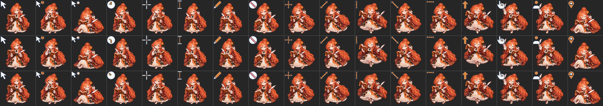

<!-- SPDX-License-Identifier: CC-BY-NC-SA-4.0 -->
<!-- Copyright (C) 2026 BigFatFish contributors -->

# AI 娘光标主题集 —— 16 套可直接安装的 Linux 动态光标

**Ubuntu 26.04 / Wayland 可直接使用的全动态鼠标光标主题 —— 克隆下来就能装。**
每个主题包含 **17 个动态光标 + 56 个别名**（`BigFatFish` 为 11 + 34），覆盖左键、忙碌、文本、
链接、缩放、移动、不可用等常用角色，全部**原生像素、不做插值放大**。



| | |
| --- | --- |
| 主题数量 | **16 套**（15 位 AI 娘 + 大肥鱼） |
| 每套内容 | 17 个动态光标（状态 / 帧 / 热点 / 时长与素材一致）+ 56 个通用别名软链；`BigFatFish` 为 11 + 34 |
| 入库原生尺寸 | 32 / 48 / 64；更大档（128 / 256）素材具备时**按需本地构建** |
| 目标平台 | Ubuntu 26.04 LTS，**Wayland** 会话（GNOME 实测；KDE 等同理） |
| 许可 | **逐个主题不同**：多数为"署名 + 禁止商用"，`DeepSeekWhale` 依其上游署名许可，3 个主题权利未确认 → [docs/SOURCES.md](docs/SOURCES.md) |
| 代码许可 | `tools/`、`install.sh` 为 **AGPL-3.0-or-later** |

---

## 主题一览

| 主题名（安装后显示） | 角色 | 许可分组 | 来源 |
| --- | --- | --- | --- |
| `BigFatFish` | 大肥鱼 / 鲸鱼娘 | CC BY-NC-SA 4.0 | 4evergr8（B 站 [BV1WypJ6WExu](https://www.bilibili.com/video/BV1WypJ6WExu/)） |
| `ChatGPTDragon` | ChatGPT 龙娘 | **权利未确认** | [chatgpt-dragon-cursors](https://github.com/nibushiyigeren123-bot/chatgpt-dragon-cursors) |
| `ClaudeOpus` / `ClaudeSonnet` / `ClaudeFable` | Claude 三姐妹 | ZipZipPipe 非商业 | [claude-sisters-cursors](https://github.com/nibushiyigeren123-bot/claude-sisters-cursors) |
| `AstraMint` / `SolMint` | 薄荷绿 GPT 姐妹 | **权利未确认** | [astra-sol-mint-cursors](https://github.com/nibushiyigeren123-bot/astra-sol-mint-cursors) |
| `DeepSeekWhale` | DeepSeek 小鲸鱼 | 大肥鱼项目署名许可 1.0 | [DeepSeek-mint-cursors](https://github.com/nibushiyigeren123-bot/DeepSeek-mint-cursors) |
| `Gemini` | Gemini 猫耳娘 | ZipZipPipe 非商业 | [gemini-cursors](https://github.com/nibushiyigeren123-bot/gemini-cursors) |
| `GLM` | GLM 黑狐耳 | ZipZipPipe 非商业 | [glm-cursors](https://github.com/nibushiyigeren123-bot/glm-cursors) |
| `Grok` | Grok 黑金双马尾 | ZipZipPipe 非商业 | [grok-cursors](https://github.com/nibushiyigeren123-bot/grok-cursors) |
| `Kimi` | Kimi 银发 | ZipZipPipe 非商业 | [kimi-cursors](https://github.com/nibushiyigeren123-bot/kimi-cursors) |
| `MiMo` | MiMo 黑白橙 | **上游非商业·作者未确认** | [mimo-cursors](https://github.com/nibushiyigeren123-bot/mimo-cursors) |
| `Qwen` | Qwen 折扇娘 | ZipZipPipe 非商业 | [qwen-cursors](https://github.com/nibushiyigeren123-bot/qwen-cursors) |
| `Seedream` | Seedream | ZipZipPipe 非商业 | [bytedance-cursors](https://github.com/nibushiyigeren123-bot/bytedance-cursors) |
| `Doubao` | 豆包 | **上游非商业·作者未确认** | 同上（豆包造型依用户提供的参考图） |

完整来源、逐主题许可义务与残余风险：[docs/SOURCES.md](docs/SOURCES.md)。

## 安装

⚠️ 安装脚本会写入 `$HOME`（`$XDG_DATA_HOME/icons`），属 [AGENTS.md](AGENTS.md) **R5** 管辖：
**默认只打印计划，加 `--yes` 才真正落盘**。

```bash
./install.sh --list                       # 看仓库里有哪些主题
./install.sh --theme Gemini                # 预览：只打印将要做什么
./install.sh --theme Gemini --yes          # 安装到 ~/.local/share/icons/Gemini

gsettings set org.gnome.desktop.interface cursor-theme 'Gemini'
# 然后注销并重新登录（Wayland 会缓存光标主题）
```

卸载（移入回收站，可恢复）：

```bash
./install.sh --theme Gemini --uninstall --yes
```

非 GNOME 桌面：在系统设置里选择对应主题名即可（KDE：系统设置 → 外观 → 光标）。

> 想一次装多套：对每个主题名重复执行即可；装好后在系统设置里随时切换，互不冲突。

## 光标大小与清晰度

合成器按 `需求像素 = round(cursor-size × 显示器缩放)` 取图；若该需求不落在主题持有的**原生档**上，
它只能拉伸，必然发虚。仓库自带选档脚本（默认只读预览）：

```bash
tools/scripts/set-cursor-size.sh                 # 只读：列出你的清晰档位与上限内最大档
tools/scripts/set-cursor-size.sh --auto --yes    # 应用「清晰前提下尽量大」
tools/scripts/set-cursor-size.sh --set 24 --yes  # 或直接指定一个值
tools/scripts/set-cursor-size.sh --reset --yes   # 恢复系统默认
```

如果你的主题是含 128 档的本地构建版本（见下节），把原生档一并告诉脚本：
`tools/scripts/set-cursor-size.sh --native 32,48,64,128`。
原理、加载器行为与验证陷阱见 [docs/TECH-NOTES.md](docs/TECH-NOTES.md)。

## 按需构建更大档（128 / 256）

入库档位是 32/48/64（控制仓库体积）；上游素材本身有 32/48/64/**128/256** 五档，
需要高清大光标时按需拉取并本地构建，**不做插值放大**：

```bash
cd tools
PYTHONPATH=src uv run python -m bigfatfish build \
  --theme Gemini --sizes 32,48,64,128 --out ../tmp/local/Gemini
cd ..

# 安装这份本地构建（--source 直接指向它，护栏仍按 index.theme 里的 Name 核对）
./install.sh --theme Gemini --source tmp/local/Gemini --yes
```

`--sizes` 只能取素材里**真实存在**的档：素材缺档时会明确报错，而不是悄悄放大
（缺档时用 `git -C assets/src/<仓库> sparse-checkout add '/cursors/*/128/'` 按需补拉）。

## 许可与署名（必读）

本仓库**不是单一许可**：16 套主题的美术分属不同来源、条件各不相同。

| 分组 | 主题 | 商用 | 你要做到的 |
| --- | --- | --- | --- |
| ZipZipPipe 非商业 | 9 套 | **禁止** | 署名 `ZipZipPipe` + 保留图库地址；同一非商业条件传递下游 |
| 上游非商业·作者未确认 | `MiMo`、`Doubao` | **禁止** | **不得**署名为 `ZipZipPipe` 或任何未确认作者；保留"原作者未确认"这一事实 |
| 大肥鱼项目署名许可 1.0 | `DeepSeekWhale` | 上游许可**允许含商用**（仅及于上游有权授权部分） | 署名 `YunYueSama` + 仓库地址，并保留完整许可文本 |
| **权利未确认** | `ChatGPTDragon`、`AstraMint`、`SolMint` | **禁止** | 如实标注"未确认"，权利人主张即移除 |
| CC BY-NC-SA 4.0（依形象链推断） | `BigFatFish` | **禁止** | 完整署名链 + 非商业 + 相同方式共享 |

- 逐主题义务与残余风险：[docs/SOURCES.md](docs/SOURCES.md)
- 每个主题目录内的 `themes/<主题名>/ATTRIBUTION.md`：**对外分发该主题时必须原样携带**
- 第三方清单、授权联络与移除通道：[THIRD-PARTY.md](THIRD-PARTY.md)
- **不得声称本项目或任何主题可以商用。**

## 目录结构

```
.
├── themes/<主题名>/              # ★ 主交付物：index.theme + cursors/ + preview.png + ATTRIBUTION.md
├── install.sh                    # 安装 / 卸载（默认 dry-run；写 $HOME 属 R5 管辖）
├── ATTRIBUTION.md                # 分层许可总览（对外分发必须携带对应主题的版本）
├── LICENSE                       # CC BY-NC-SA 4.0（本项目原创文档；主题美术另见各 ATTRIBUTION.md）
├── THIRD-PARTY.md                # 第三方清单、授权联络与移除通道
├── docs/
│   ├── SOURCES.md                # ★ 逐主题来源与许可总表
│   ├── PROVENANCE.md             # 来源取证记录（脱敏）
│   └── TECH-NOTES.md             # 格式、加载器实测、尺寸/缩放原理
├── assets/                       # 本地素材区（**不入库**）：Windows 原始包 + 上游仓库稀疏克隆
└── tools/                        # 从 .ani 重建全部主题的转换器（AGPL-3.0-or-later）
    ├── LICENSE                   # AGPL 全文
    ├── pyproject.toml / uv.lock  # uv 项目定义与锁文件（零第三方依赖）
    ├── src/bigfatfish/           # ani / xcursor / catalog / theme / preview / __main__
    ├── tests/                    # 86 项 stdlib unittest（含独立 XCursor 交叉校验器）
    └── scripts/set-cursor-size.sh
```

## 从素材重新构建（可选）

主题已经构建好，普通用户不需要这一步。要重建：

1. 自备素材（**原始素材不入库**，见 [assets/README.md](assets/README.md)）：
   - `BigFatFish`：`.ani` + `install.inf` 放到 `assets/BigFatFish/`
   - 合集主题：上游仓库稀疏克隆到 `assets/src/<仓库>/`（命令见 [docs/PROVENANCE.md](docs/PROVENANCE.md) §1）
2. 构建与查看：

```bash
export PATH="$HOME/.local/bin:$PATH"                             # uv 可能只装在 ~/.local/bin
cd tools
PYTHONPATH=src uv run python -m bigfatfish themes                # 主题清单（含来源与许可分组）
PYTHONPATH=src uv run python -m bigfatfish list --theme Gemini    # 角色映射表
PYTHONPATH=src uv run python -m bigfatfish build --all           # 重建 themes/ 下全部主题
PYTHONPATH=src uv run python -m bigfatfish build --theme Gemini --sizes 32,48,64,128
```

构建会同时重写 `index.theme`、`cursors/` 与 `preview.png`；`ATTRIBUTION.md` 是静态文档，不会被覆盖。

## 已知限制

- 入库只有 32/48/64 三档；桌面请求的尺寸若不落在原生档上会被拉伸（见上文选档脚本与按需构建）。
- `BigFatFish` 的上游素材只有 32/48/64，没有更大的原生档可拉取。
- 只走 `libXcursor` 的 X11 应用默认不搜索 `~/.local/share/icons`（Wayland 桌面的加载器会搜索）：
  若 X11 应用看不到主题，用 `XCURSOR_PATH` 或在 `~/.icons/` 放软链。详见 [docs/TECH-NOTES.md](docs/TECH-NOTES.md) §2。
- 不支持 PNG 压缩的 ICO 帧（遇到会明确报错）；本项目素材为 `BI_RGB` DIB。
- `theme.py` 不清理上一版多出来的光标文件（删除他人文件的风险高于收益）。
- `tools/` 需要 Python 3.11+，零第三方依赖；ruff 尚未引入，质量由 86 项测试与目视 / 加载器验证保证。

## 开发

```bash
cd tools
uv sync                                                    # 零依赖，无需联网装包
PYTHONPATH=src uv run python -m unittest discover -s tests -v
```

协作规约（Git / uv / 隐私零暴露 / 最小改动 / 工作区外改动须汇报）见 [AGENTS.md](AGENTS.md)。
