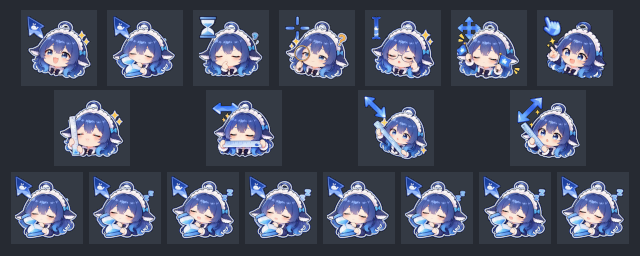

<!-- SPDX-License-Identifier: CC-BY-NC-SA-4.0 -->
<!-- Copyright (C) 2026 BigFatFish contributors -->

# 大肥鱼（BigFatFish）光标主题

**Ubuntu 26.04 / Wayland 可直接使用的全动态鼠标光标主题 —— 克隆下来就能装。**



| | |
| --- | --- |
| 内容 | 11 个动态光标 + 34 个别名，覆盖左键、忙碌、文本、缩放、移动等常用角色 |
| 原生尺寸 | 32 / 48 / 64 三档（不做插值放大，见[光标大小与清晰度](#光标大小与清晰度)） |
| 目标平台 | Ubuntu 26.04 LTS，**Wayland** 会话（GNOME 实测；KDE 等同理） |
| 主题许可 | 美术层 **CC BY-NC-SA 4.0**（非商业），见 [ATTRIBUTION.md](ATTRIBUTION.md) |
| 代码许可 | `tools/`、`install.sh` 为 **AGPL-3.0-or-later** |

---

## 安装

⚠️ 会写入 `$HOME`（`$XDG_DATA_HOME/icons`），属 [AGENTS.md](AGENTS.md) **R5** 管辖：**默认只打印计划，加 `--yes` 才真正落盘**。

```bash
./install.sh                 # 预览：只打印将要做什么
./install.sh --yes           # 安装到 ~/.local/share/icons/BigFatFish

gsettings set org.gnome.desktop.interface cursor-theme 'BigFatFish'
# 然后注销并重新登录（Wayland 会缓存光标主题）
```

卸载（移入回收站，可恢复）：

```bash
./install.sh --uninstall --yes
```

非 GNOME 桌面：在系统设置里选择 `BigFatFish` 即可（KDE：系统设置 → 外观 → 光标）。

## 光标大小与清晰度

本主题只有 32 / 48 / 64 三档**原生**像素。合成器按 `需求像素 = round(cursor-size × 显示器缩放)` 取图；
需求若落在这三档之外，它只能拉伸现有档，**必然发虚**。清晰条件因此是：

```
cursor-size ≈ 原生档 ÷ 显示器缩放
```

**每台机器的缩放不同，必须现场实测**（仓库不记录任何具体机器的参数）。仓库自带选档脚本：

```bash
tools/scripts/set-cursor-size.sh                 # 只读：列出你的清晰档位与上限内最大档
tools/scripts/set-cursor-size.sh --auto --yes    # 应用「清晰前提下尽量大」
tools/scripts/set-cursor-size.sh --set 24 --yes  # 或直接指定一个值
tools/scripts/set-cursor-size.sh --reset --yes   # 恢复系统默认
```

原理、加载器行为与验证陷阱见 [docs/TECH-NOTES.md](docs/TECH-NOTES.md)。

## 署名与许可（必读）

本主题是**第三方美术作品的演绎作品**：只做了格式转换（Windows 动画光标 → XCursor），未改动美术。

| 环节 | 作者 |
| --- | --- |
| 原始角色形象 | 上善无形 |
| 二创与授权声明（CC BY-NC-SA 4.0） | ZipZipPipe |
| Windows 光标包 | 4evergr8（[BV1WypJ6WExu](https://www.bilibili.com/video/BV1WypJ6WExu)） |

完整声明、你必须履行的义务（**署名 / 非商业 / 相同方式共享**）与已知残余风险，
见 **[ATTRIBUTION.md](ATTRIBUTION.md)** —— 对外分发时必须原样携带。

## 目录

```
.
├── BigFatFish/                   # 主题本体：index.theme + cursors/（11 光标 + 34 别名）
├── install.sh                    # 安装 / 卸载（默认 dry-run；写 $HOME 属 R5 管辖）
├── ATTRIBUTION.md                # 署名与许可（对外分发必须携带）
├── LICENSE                       # CC BY-NC-SA 4.0（主题美术与文档）
├── THIRD-PARTY.md                # 第三方权属、授权联络与移除通道
├── docs/
│   ├── PROVENANCE.md             # 来源取证记录（脱敏）
│   ├── TECH-NOTES.md             # 格式、加载器实测、尺寸/缩放原理
│   └── preview.png               # 预览图
├── assets/                       # 本地素材区（**不入库**）：Windows 原始包与解包结果
└── tools/                        # 从 .ani 重新生成主题的转换器（AGPL-3.0-or-later）
    ├── LICENSE                   # AGPL 全文
    ├── pyproject.toml / uv.lock  # uv 项目定义与锁文件（零第三方依赖）
    ├── src/bigfatfish/           # ani.py / xcursor.py / theme.py / __main__.py
    ├── tests/                    # 50 项 stdlib unittest（含独立交叉校验器）
    └── scripts/set-cursor-size.sh
```

## 从素材重新构建（可选）

主题已经构建好，普通用户不需要这一步。要从 Windows 原始包重建：

1. 自备素材（`.ani` + `install.inf`）放到 `assets/BigFatFish/`（**原始素材不入库**，见 `.gitignore`）
2. 构建：

```bash
export PATH="$HOME/.local/bin:$PATH"                # uv 可能只装在 ~/.local/bin
cd tools
PYTHONPATH=src uv run python -m bigfatfish build    # 重新生成 ../BigFatFish/
PYTHONPATH=src uv run python -m bigfatfish list     # 只看角色映射表（来自 install.inf）
```

## 已知限制

- 只输出素材**原生**的 32 / 48 / 64 档，不做插值放大（放大不增加真实细节）。桌面请求的尺寸若不落在原生档上会被拉伸 —— 用选档脚本避开。
- 不支持 PNG 压缩的 ICO 帧（遇到会明确报错）；本项目素材为 `BI_RGB` DIB。
- `tools/` 需要 Python 3.11+，零第三方依赖。
- ruff 尚未引入；质量由 50 项测试与视觉验证保证。

## 开发

```bash
cd tools
uv sync                                                    # 零依赖，无需联网装包
PYTHONPATH=src uv run python -m unittest discover -s tests -v
```

协作规约（Git / uv / 隐私零暴露 / 最小改动 / 工作区外改动须汇报）见 [AGENTS.md](AGENTS.md)。
